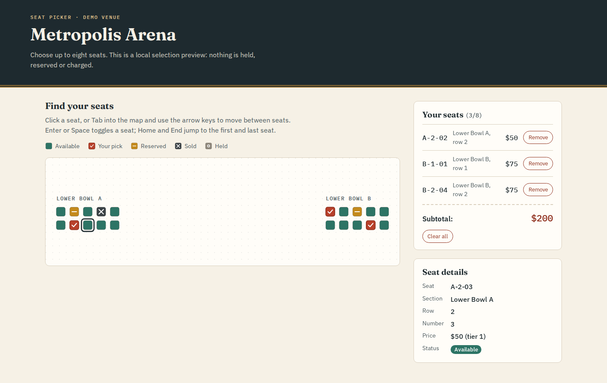
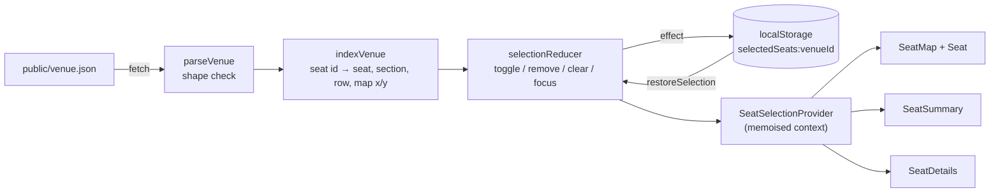

# Seat Picker: an SVG event-seating take-home

A frontend take-home exercise: pick up to eight seats on an SVG venue map, see what they cost, and find the same selection again after a reload. It is built with React 19, TypeScript and Vite, and it runs entirely in the browser. There is no backend, account, checkout or reservation. The repository folder keeps its original take-home name, `take-home-assesment-frontend`, and the npm package is `event-seating-map-frontend`.



The screenshots use the synthetic "Metropolis Arena" venue in `public/venue.json`: 20 seats in two sections. A [mobile view](docs/screenshots/seating-mobile.png) shows the narrow layout, where the map keeps seats at a tappable size and scrolls sideways.

## What it does

- Draws every section and seat from `public/venue.json`, applying each section's `translate`/`scale` transform, and fits the view to the seats.
- Lets you select and deselect available seats by mouse, touch or keyboard, up to a cap of eight. Reserved, sold and held seats can be focused and inspected but not selected.
- Marks each status with a shape as well as a colour (tick, bar, cross, ring), so the map still reads without colour.
- Keeps a running subtotal from fixed demo prices: tier 1 is $50, tier 2 $75, tier 3 $100 and tier 4 $150. A seat with an unknown tier shows "Price unavailable" and is left out of the total rather than counted as free.
- Lets you remove seats one at a time or clear them all, and announces each outcome (added, removed, cap reached, seat unavailable) in a polite live region.
- Saves the selection in `localStorage` per venue and restores it on the next visit.

## Running it

You need Node.js 22 (see `.nvmrc`) and pnpm 12, which Corepack provides from the `packageManager` field:

```sh
corepack enable
pnpm install --frozen-lockfile
pnpm dev            # http://localhost:5173
```

| Command        | What it does                                              |
| -------------- | --------------------------------------------------------- |
| `pnpm dev`     | Vite dev server with hot reload                           |
| `pnpm build`   | Type-checks both TypeScript projects, then builds `dist/` |
| `pnpm preview` | Serves the production build locally                       |
| `pnpm test`    | Runs the Vitest suite once (jsdom)                        |
| `pnpm lint`    | ESLint 10 flat config, zero warnings allowed              |

pnpm 12 refuses packages published less than a day ago (`minimumReleaseAge`), so a fresh lockfile resolution can choose a slightly older patch release than the newest on npm. That is intended.

### With Docker

The image builds the bundle in `node:22-bookworm-slim` and serves it from `nginx:1.30-alpine` as the unprivileged `nginx` user on port 8080:

```sh
docker build -t seat-picker .
docker run --rm -p 8080:8080 seat-picker   # http://localhost:8080
```

No environment variables are needed. Headings and body text use Google Fonts (Fraunces and IBM Plex), with system fallbacks when they cannot load.

## How it fits together



- **`src/lib/venue.ts`** checks the venue JSON shape once, at the boundary. It builds a `Map` from seat id to seat, section, row and rendered position, and computes the view box. It also finds the nearest seat in a given direction for arrow-key movement.
- **`src/lib/selection.ts`** is a pure reducer holding the cap, the availability rules and the announcement text, plus `restoreSelection` for saved data.
- **`src/lib/pricing.ts`** is the single price table, the subtotal and the currency formatting.
- **`src/context/`** wires the reducer into React and writes the selection back to storage.

## Design choices

**Only changed seats re-render.** Click, key, focus and hover handlers sit once on the `<svg>` and find the seat through `data-seat-id`. Each `Seat` receives only data props (`entry`, `isSelected`, `isTabStop`), so `React.memo` skips every seat whose state did not change. A test renders a 2,000-seat venue and checks that a click re-renders exactly two seats: the clicked one and the previous tab stop.

**One tab stop for the whole map.** The map uses a roving `tabindex`. Tab enters the map at the last focused seat, the arrow keys move to the nearest seat by rendered position (preferring the same row or column), Home and End jump to the ends, and Enter or Space toggles a seat. Every seat is a `button` with a label such as "Lower Bowl A, row 2, seat 3, $50, available". It has `aria-pressed` when the seat can be selected and `aria-disabled` when it cannot, and sections are labelled groups.

**Saved data is never trusted for prices.** `restoreSelection` keeps only IDs that still exist and are available, drops duplicates, caps the list at eight and rebuilds section, row and tier from the venue. A hand-edited `localStorage` entry therefore cannot change a price. Corrupt JSON, the wrong shape, or storage that throws (private mode, quota) just means an empty selection, and the next change overwrites the bad value.

**Status is not colour-only.** Each status has its own mark, and the legend above the map uses those same marks.

## Tests

`pnpm test` runs 52 Vitest and Testing Library tests:

- the reducer and `restoreSelection`;
- pricing;
- venue parsing, indexing, the view box and nearest-seat lookup;
- the full app in jsdom: the eight-seat cap, unavailable seats, keyboard navigation and toggling, persistence and restore, corrupt or throwing storage, subtotals, and loading errors;
- the large-venue render count described above.

## Venue data

`public/venue.json` holds a venue id and name, plus sections with a label, a `transform` (`x`, `y`, `scale`) and rows of seats. Each seat has an `id`, `col`, `x`, `y`, `priceTier` and a `status` of `available`, `reserved`, `sold` or `held`. If the file does not match that shape, the app shows an error instead of a broken map.

## Limits

- It is a selection preview only. Availability comes from a static file, and nothing is locked, synchronised between tabs or sent anywhere.
- Prices are fixed demo values keyed by tier.
- The bundled venue is small. The rendering approach is checked at 2,000 seats in tests, but there is no measured frame-rate benchmark and no virtualisation for very large maps.
- Keyboard and ARIA behaviour is covered by automated tests and a headless Chromium check. It has not been reviewed with a real screen reader.
- `pnpm audit` reports one moderate advisory, in the `minimatch` version that ESLint uses. It only affects the lint toolchain, not the shipped bundle.

## License

MIT, see [LICENSE](LICENSE).
