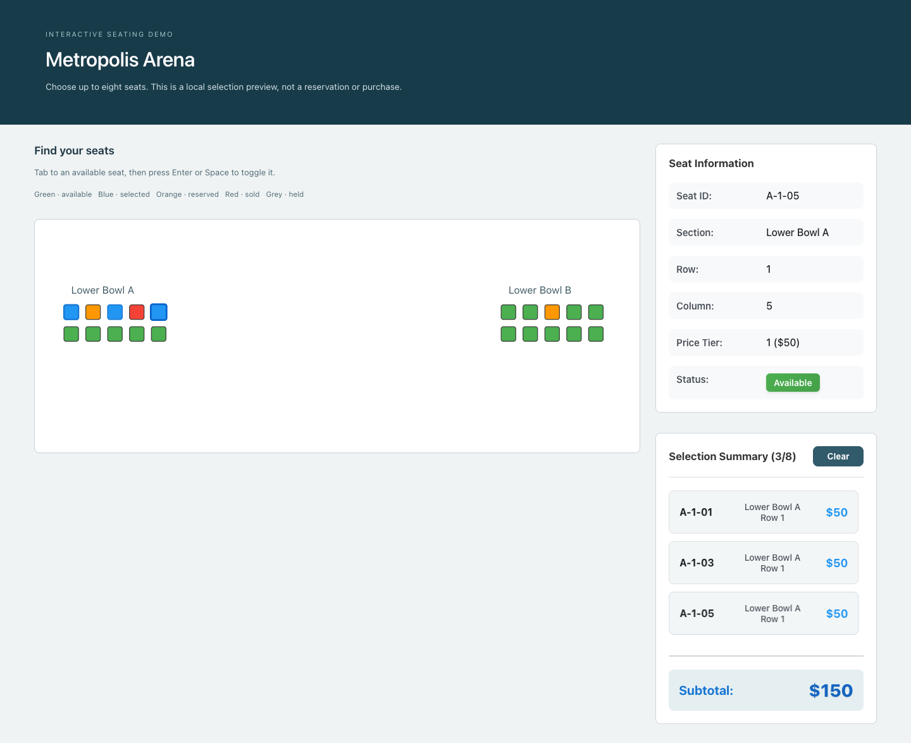

# Event seating-map exercise

A React/TypeScript SVG interface for choosing up to eight seats from a bundled demonstration venue. The checked-in venue contains **20 seats across two sections**, not a 15,000-seat performance benchmark. This is a browser-only exercise and is unrelated to the similarly named user-cache backend repository.



The screenshot uses the synthetic Metropolis Arena data from `public/venue.json`. [Mobile preview](docs/seating-mobile.png) shows the map before the summary, with horizontal scrolling inside the map to keep seat targets readable. No real event, account, payment, or attendee data is involved.

## Try it

Use Node.js 22 and pnpm 9:

```sh
pnpm install --frozen-lockfile --ignore-scripts
pnpm dev
```

Open `http://localhost:5173`. `pnpm build` checks TypeScript and creates a Vite production bundle; `pnpm preview` serves it locally. No environment values, database, or provider account are required.

Click an available seat, or Tab to it and use Enter/Space to toggle selection. Blue seats are selected; the legend explains other statuses. The sidebar shows seat details and a subtotal. Price tiers are fixed demo values ($50/$75/$100/$150), not quotes from a ticketing provider. Clearing the summary removes the current selection. There is no checkout, reservation lock, expiry timer, booking endpoint, or inventory synchronization.

## State and layout choices

`SeatSelectionProvider` owns venue data, selection, focused-seat details, and persistence. Consumers share that state without each mounting its own storage effects. Persisted selections are scoped to `selectedSeats:<venueId>` and restored only after the venue loads. Restoration accepts at most eight unique, currently available IDs and rebuilds their section, row, and price tier from venue data. Unknown/unavailable IDs, duplicate records, and saved price overrides are discarded. Corrupt or blocked local storage does not prevent browsing. The old unscoped `selectedSeats` key is not imported.

SVG section groups now apply their `translate` and `scale` transforms, and the view fits the rendered seat bounds. The original map dimensions remain source metadata rather than forcing a large empty canvas. Seat buttons expose pressed state and visible focus. The map is not assigned an image role that hides its interactive descendants. This is basic keyboard support, not a full assistive-technology audit; arrow-key navigation and an alternative seat list are not implemented.

`React.memo` is present, but inline callbacks and shared context still cause render work. No frame-rate measurement or large-venue scalability result is claimed. Persistence writes on selection changes; it is not debounced, and it is not a cross-tab reservation protocol.

## Verification

```sh
pnpm build
pnpm lint
```

Both pass. A real Chrome check against the production preview verified all 20 seats, keyboard selection, click selection, reload persistence, clear/reload, the eight-seat cap, corrupt JSON, duplicate/unavailable/unknown stored IDs, and reconstruction of the canonical $50 price despite a saved override. Desktop and 390px layouts were checked without document-level horizontal overflow; the mobile map intentionally scrolls internally. The browser check used the bundled venue and fresh browser storage, with no personal profile or external service.

The browser verification script is retained in the private review evidence rather than adding a new dependency to this small exercise. No unit runner, 15,000-seat benchmark, Firefox/WebKit check, or screen-reader evaluation was performed. Future work should start with runtime validation of replacement venue JSON, roving keyboard focus for larger maps, a server-backed availability contract, and measured rendering costs if the data grows.
